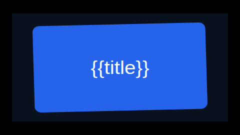
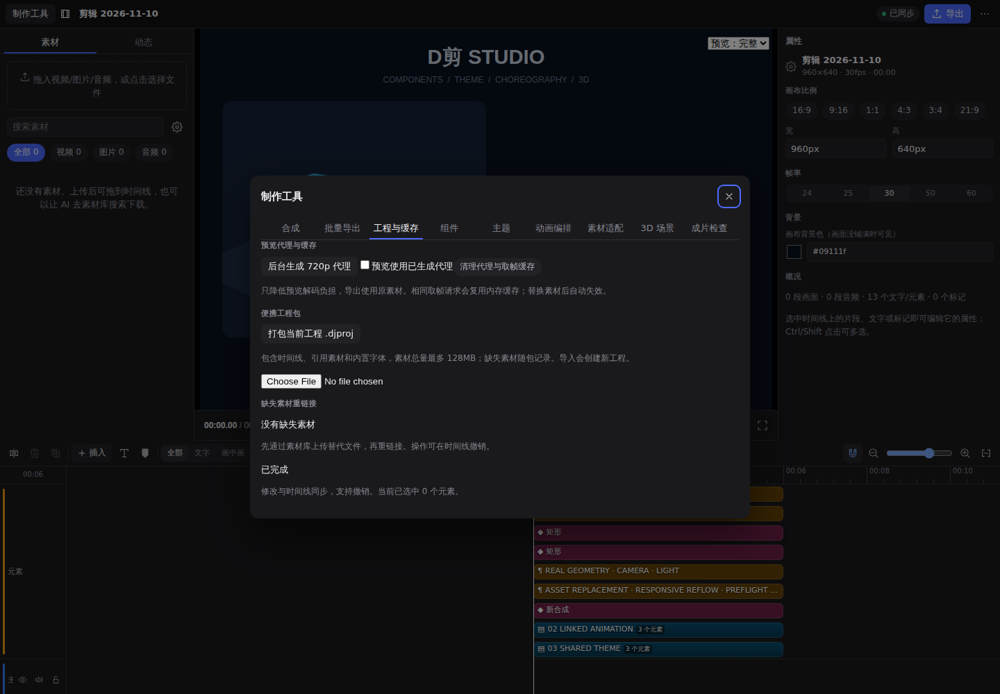

# 2.10.0 工程工作流

入口：时间线上方 **制作工具** → **合成 / 批量导出 / 工程与缓存**。继续兼容此前的组件、主题、动画、3D 与成片检查。

## 嵌套合成

1. 选择若干元素；已有分组必须完整选择，跟随、连接、遮罩和形变关联的对象要一起选。
2. 在“合成”页命名，点击“将所选元素预合成”。外层保留原画面位置与时间范围。
3. 选中合成后，可通过常规属性调整整体位置、大小、旋转、遮罩和动画；合成页可设置源入点、倍速和声音增益。
4. 内部时间线通过 JSON 编辑器校验保存。该版本尚未提供双击进入子画布的图形编辑模式。

合成内部支持独立画布、视频、配乐与元素，最多四层。内部音频跟随裁切和变速，保留音量包络、淡入淡出、静音与配乐闪避；内层视觉和外层变换使用相同预览/导出实现。高级主轨转场的跨剪辑音频预滚不在内部音频映射范围，要求精确转场音频时请先混音为单独音轨。

预合成操作可撤销；原有的外部动画依赖会保留开始时间。合成是自包含副本，复制后分别编辑，不会自动同步成组件定义。

时间线 v17 新增可选元素字段：

```json
{
  "composition": {
    "name": "标题卡",
    "timeline": "内部时间线的 JSON 字符串",
    "inPoint": 0,
    "speed": 1,
    "volume": 1
  }
}
```

## 代理与缓存

“工程与缓存”页点击“后台生成 720p 代理”，然后勾选“预览使用已生成代理”。只为已引用的视频生成，保留原声，以 H.264/AAC 保存到项目 `.proxies` 目录。生成时界面仍可操作，状态显示成功或错误；再次点击可重试失败文件。

代理按原文件名、大小、修改时间及编码参数校验。只有预览读取代理，正式导出始终读取原素材。暂不提供手动中止单个代理任务。

服务端取帧缓存最多 48 项、32MB，键包含完整时间线、素材状态和取帧参数，支持自定义时间线；相同在途请求共用任务。点击“清理代理与取帧缓存”可释放这些缓存，不删除原素材。正在生成代理时需待任务完成再清理。

## CSV/JSON 批量生成

在需要变化的文字、颜色或素材文件名里使用 `{{列名}}`。例如标题为 `{{title}}`，CSV：

```csv
title,_name
春季新品,春季版
夏季新品,夏季版
```

或 JSON：

```json
[
  {"title": "春季新品", "_name": "春季版"},
  {"title": "夏季新品", "_name": "夏季版"}
]
```

支持 CSV 引号、逗号、换行、双引号转义及 UTF-8 BOM。JSON 值可以是文字、数字、布尔值或 null。最多 100 条、数据文件最多 1MB；缺列、重复表头、不合法时间线、缺失素材会拒绝提交。

先点击“校验数据”，再“加入导出队列”。每项保存完整时间线快照，原工程保持不变。队列串行执行，显示状态、进度、错误，并支持取消、重试和下载 MP4。界面默认标准质量、原画布尺寸；AI/API 可指定质量和尺寸倍率。

队列属于当前引擎会话，重启后需重新提交；最多 100 项等待/运行任务，保留最近 100 项完成状态。输出文件按既有策略最多保留 20 个。

## 便携工程与重链接

点击“打包当前工程 .djproj”，保存时间线、被引用素材（包括内部合成及组件）和内置字体。导入会创建独立新工程，可在项目列表打开。该格式是带 JSON 清单的 gzip 包；每个文件包含长度和 SHA-256 校验，不依赖操作系统压缩软件。

素材及字体总量上限 128MB，工程包解压后 JSON 上限 200MB。导入拒绝路径穿越、重复文件名、未知字体及校验不符的内容。只导入工程内容，不包含历史、缓存、代理或导出成片。字体使用当前版本同名的内置字体；包内字体用于补全缺失文件。

已有缺失素材仍可打包，导入后显示缺失列表。先在素材库上传替代文件，再在“缺失素材重链接”中选择替代项。重链接覆盖内外合成、组件及实例引用，保持原有动画与布局，可撤销；短音视频按现有规则调整入点和倍速。

## AI 和 API

- `djian_project_tools`：预合成、代理生成、清缓存、查缺失素材、重链接、导出队列及取消/重试。
- `djian_batch`：校验或提交 CSV/JSON 批量生成。
- `djian_project_archive`：导出到本地绝对路径或从路径导入工程包；导出不覆盖已有文件。
- 元素 `composition` 可经 `djian_apply_ops` 新增、修改或清除。

HTTP：`/api/p/:pid/precompose`、`proxies`、`cache`、`batch`、`queue`、`missing`、`relink`、`archive`；导入使用 `POST /api/projects/import-archive` 二进制请求体，其他写请求使用 JSON。延用 `X-Djian-Client` 安全头要求。

## 验证与示例

- `npm run check`：引擎和两个面板的类型检查。
- `npm test`：旧项目兼容、合成深度校验、素材递归替换、动画依赖修复、CSV/JSON 与音频时间映射等。
- `npm run test:workflow`：真实嵌套画面与有声导出、队列取消/重试、代理编码、工程往返、缺失素材重链接与损坏包拒绝。
- `npm run test:project-ui`：真实浏览器操作新面板并检查页面错误。

示例：[project-workflow.json](../examples/project-workflow.json)。本地验证产物为 `dist/project-workflow.mp4` 和 `dist/project-workflow.djproj`。



