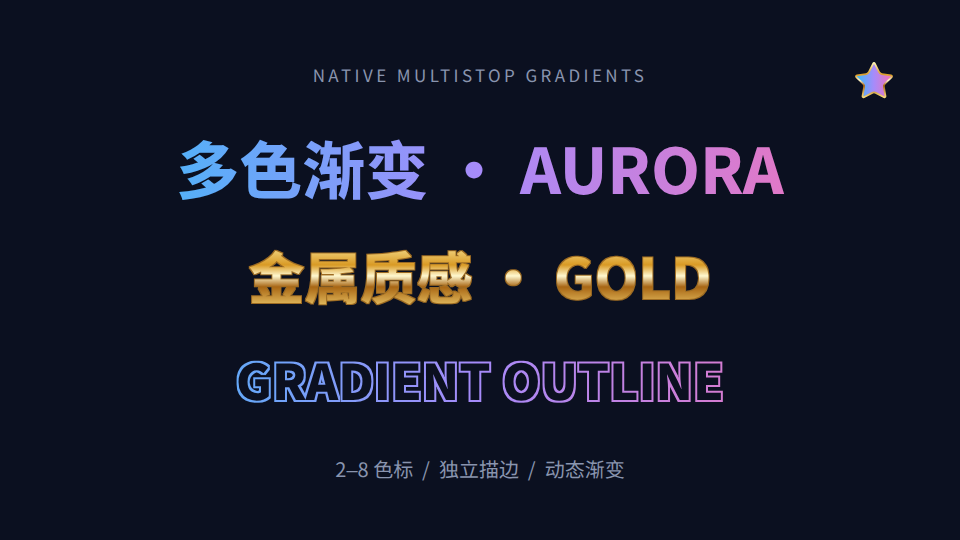

# 文字与图标多色渐变

文字填充、文字描边、图标内部填充和图标描边都支持 2–8 个色标的线性／径向渐变，预览和导出共用渲染实现。



在文字属性里打开「文字填充」，选择渐变类型，再增删色标、修改颜色和位置。线性渐变角度 0° 从左到右，90° 从上到下。「极光渐变」「金属金」可作为起点。

文字描边先开启「描边」并设置宽度，再选独立的渐变。字面和描边可以一个纯色、一个渐变，透明字面仍可保留描边。图标的「描边颜色」和「内部填充」也可分别设置。

在「渐变关键帧」选择对应通道，在播放头添加关键帧，编辑色标颜色、位置、角度及缓动。也可通过「渐变运动」旋转、移动色标和改变色相。切分或变形为下一片段时会延续原动画进度；复制、保存、恢复和撤销保留这些参数。

```json
{
  "op": "addOverlay",
  "id": "gradient-title",
  "kind": "text",
  "text": "多色渐变",
  "startSeconds": 0,
  "endSeconds": 4,
  "fontSize": 96,
  "textFill": {
    "type": "linear",
    "angle": 0,
    "stops": [
      { "offset": 0, "color": "#38bdf8" },
      { "offset": 0.5, "color": "#a78bfa" },
      { "offset": 1, "color": "#f472b6" }
    ]
  },
  "stroke": { "color": "#ffffff", "width": 3 }
}
```

AI 参数：

| 字段 | 用途 |
|---|---|
| `textFill` | 文字填充；未设置时使用 `color` |
| `textStrokeFill` | 文字描边填充；宽度由 `stroke.width` 控制 |
| `icon.strokeFill` | 图标描边；未设置时使用 `color` |
| `icon.fill` | 图标内部填充；未设置时不填充 |

上述字段可用纯色或渐变对象，渐变可带 `keyframes:[{t,stops,angle,e}]`。时间是相对元素起点的秒数；每帧含 2–8 个色标。`gradientAngle`、`gradientShift`、`gradientHue` 动画通道同时作用于该元素的各个渐变。

文字字面渐变统一覆盖整段文字，包括富文本中的强调色。字号、加粗、自动换行、逐字动画仍保留。仅使用渐变描边时，原有字面颜色不变。图标与文字作为亮度遮罩源时，会使用当前渐变颜色。

时间线格式升级到 v21，旧项目自动迁移；旧引擎打开新格式时保持只读，避免丢失渐变字段。
